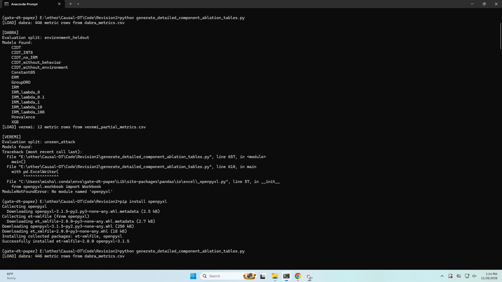
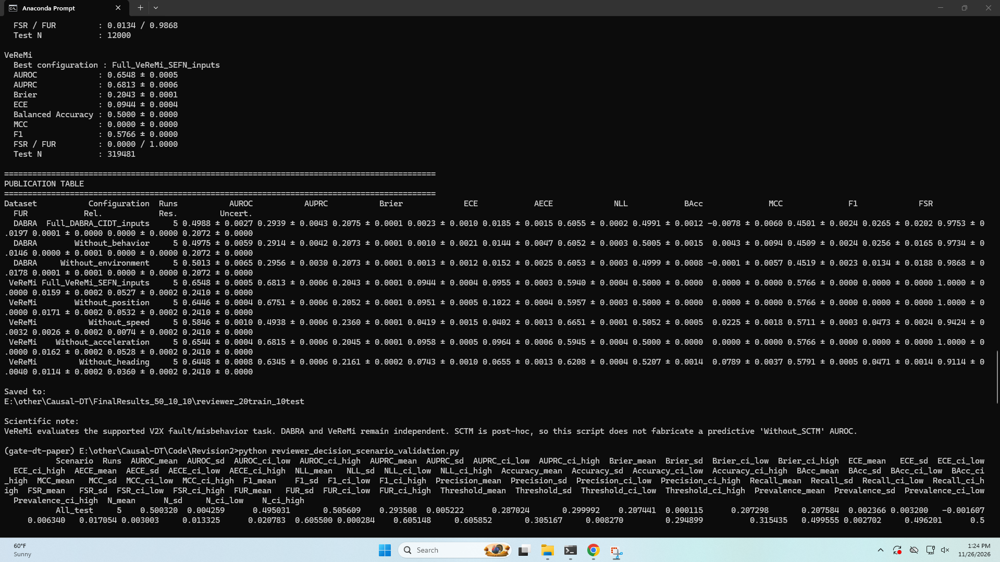
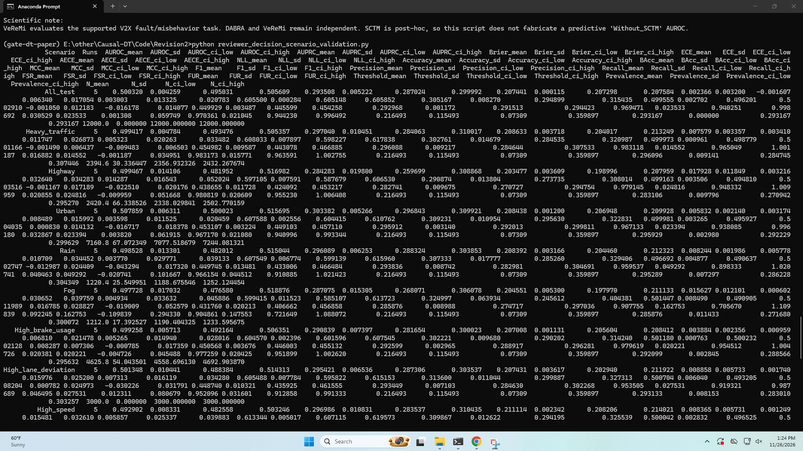
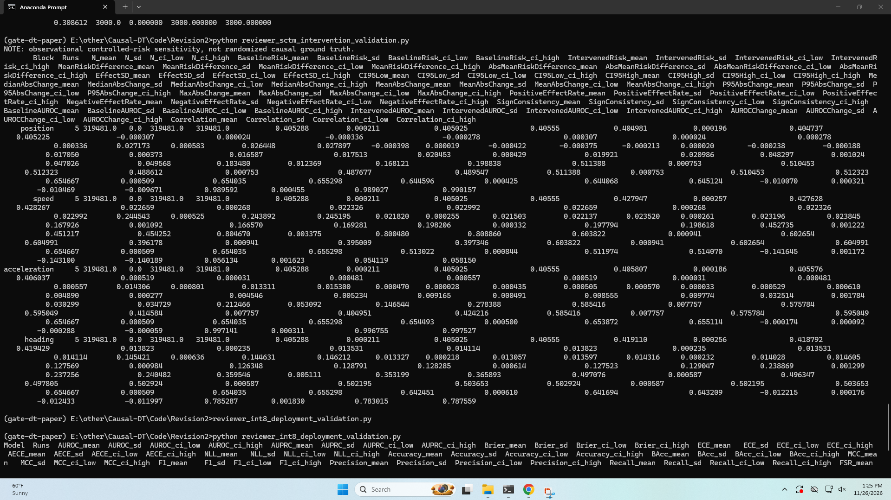
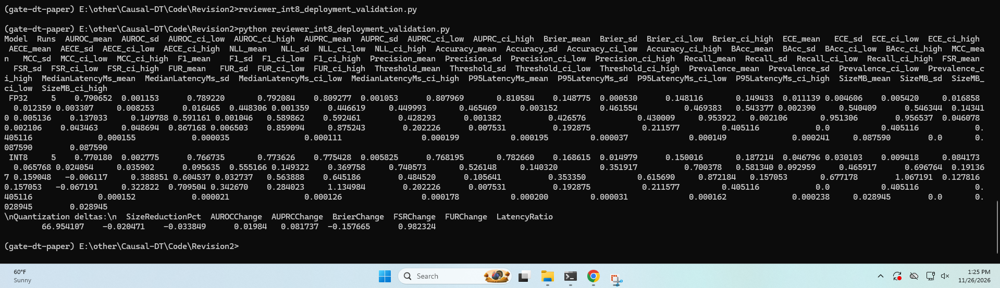

# Experimental Results

This directory contains figures generated from the Anaconda/Python experimental analysis for the paper **“Causal-Invariant Digital Twin for Robust Autonomous Vehicle Decision Validation under V2X Distribution Shifts.”**

## Figure 1

## Figure 2

## Figure 3

## Figure 4

## Figure 5

## Main Repository

https://github.com/mishaurooj/Causal-Invariant-Digital-Twin/tree/main
